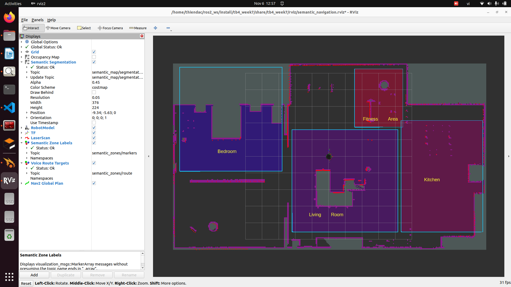

# TurtleBot 4 – Week 7: Semantic Map và Voice Navigation

Các vùng Semantic gồm `Bedroom`, `Living Room`, `Kitchen` và `Fitness Area`.




## Yêu cầu môi trường

- Ubuntu + ROS 2 Humble.
- TurtleBot 4 Simulation, Nav2, Gazebo Ignition và các package TurtleBot 4 liên quan.
- Python 3, PyYAML.
- Microphone và Vosk nếu muốn nhận giọng nói thật.

Cài Vosk và sounddevice:

```bash
python3 -m pip install --user vosk sounddevice
```

Tải model tiếng Việt Vosk và giải nén, ví dụ:

```text
/home/$USER/models/vosk-model-small-vn-0.4
```

## Clone và build

Clone repository vào thư mục source của ROS 2:

```bash
cd ~/ros2_ws/src
git clone https://github.com/23020734-thiendac/voice_navigation.git
cd ~/ros2_ws
source /opt/ros/humble/setup.bash
colcon build --symlink-install --packages-select tb4_week7
source install/setup.bash
```

Nếu repository được clone ở vị trí khác trong workspace, chạy `colcon build` từ root workspace để colcon tự tìm package.

## Chạy toàn bộ hệ thống

```bash
cd ~/ros2_ws
source /opt/ros/humble/setup.bash
source install/setup.bash
export ROS_DOMAIN_ID=68
ros2 launch tb4_week7 week7_voice_navigation.launch.py \
  ros_domain_id:=68 \
  x:=0.0 y:=0.0 yaw:=0.0 \
  show_rviz:=true \
  voice_backend:=auto \
  voice_model_path:=/home/$USER/models/vosk-model-small-vn-0.4
```

Launch tự mở Gazebo Small House, spawn TurtleBot 4, khởi động localization, Nav2, semantic map, nhận dạng giọng nói và RViz. World, model, texture và launch mô phỏng cần thiết đã nằm trong `tb4_week7/simulation`; không cần package gesture tuần 6 và không spawn dock sạc.

## Câu lệnh giọng nói

Lệnh đơn:

```text
Đi tới phòng ngủ
Đi tới phòng khách
Đi tới phòng bếp
Đi tới chỗ tập
Dừng
```

Lệnh chuỗi:

```text
Đi từ phòng ngủ qua phòng khách rồi tới phòng bếp
```

Robot sẽ đi lần lượt `Bedroom → Living Room → Kitchen`. Khi nói `Dừng`, goal Nav2 bị hủy và robot nhận vận tốc bằng 0.

## Topic và action chính

| Kênh | Kiểu | Chức năng |
|---|---|---|
| `/voice_command` | `std_msgs/String` | câu đã nhận dạng từ microphone |
| `/voice_command_text` | `std_msgs/String` | kênh kiểm thử bằng văn bản |
| `/voice_navigation_status` | `std_msgs/String` | trạng thái phân tích và điều hướng |
| `/semantic_map/segmentation` | `nav_msgs/OccupancyGrid` | bản đồ có mã vùng Semantic |
| `/semantic_zones/markers` | `visualization_msgs/MarkerArray` | biên và nhãn vùng trên RViz |
| `/semantic_zones/route` | `visualization_msgs/MarkerArray` | các đích của chuỗi lệnh |
| `/navigate_to_pose` | `nav2_msgs/action/NavigateToPose` | action Nav2 nhận từng đích |
| `/cmd_vel` | `geometry_msgs/Twist` | vận tốc điều khiển robot |

## Cấu trúc package

```text
tb4_week7/
├── config/
│   └── zones.yaml                         # polygon, nhãn và tọa độ đích
├── launch/
│   ├── week7_voice_navigation.launch.py   # launch tổng tuần 7
│   └── small_house_sim.launch.py
├── maps/
│   ├── small_house_slam.pgm               # bản đồ điều hướng
│   ├── small_house_slam.yaml
│   ├── small_house_regions.pgm            # ảnh phân vùng trực quan
│   └── small_house_regions.yaml
├── rviz/
│   └── semantic_navigation.rviz
├── simulation/
│   ├── worlds/small_house.world           # world Small House
│   ├── models/
│   └── photos/
├── tb4_week7/
│   ├── map_segmentation_node.py           # semantic map và marker vùng
│   ├── voice_recognition_node.py          # microphone + Vosk
│   ├── voice_navigation_node.py           # phân tích lệnh + Nav2
│   ├── voice_monitor_node.py              # chuyển giọng nói thành văn bản hiển thị để quan sát
│   └── initial_pose_publisher.py          # pose ban đầu cho AMCL
├── tools/generate_segmented_map.py        # tạo small_house_regions.pgm
├── package.xml
├── setup.py
└── README.md
```
